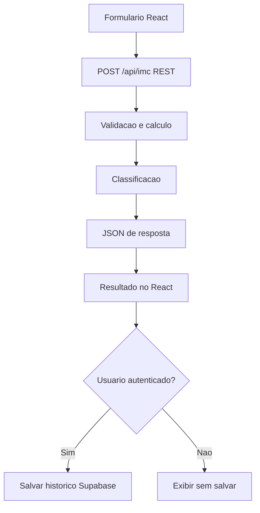

# Tutorial 2 — IMC React: testes automatizados, GitHub Actions e CI/CD na Vercel

**Disciplina:** Métodos e Ferramentas de Desenvolvimento de Software.
**Projeto:** Meu IMC (React + Vite + Supabase + Google Auth + Stripe + Vercel).

Este tutorial começa **depois** da conclusão do Tutorial 1. Não crie outro projeto, outro banco ou outro produto Stripe. Não execute novamente o SQL do Tutorial 1. Não substitua o tutorial anterior nem os arquivos de pagamento corrigidos. O objetivo é evoluir o próprio sistema que já funciona, adicionando uma API de IMC, quatro modalidades de testes, integração contínua (CI), proteção da branch `main` e entrega contínua (CD). Não haverá Docker, nem uma segunda conta GitHub para a revisão.

O experimento final mostrará um Pull Request com um defeito proposital, bloqueado pelos testes, corrigido na mesma branch e publicado na Vercel somente depois das verificações. Uma única conta autorizada por equipe cria commits, abre o PR e realiza o merge; não há aprovação humana simulada.

**Índice**

1. Conferir o projeto e o ambiente Windows.
2. Verificar Git, credenciais e branch de trabalho.
3. Instalar Playwright e criar a estrutura de testes.
4. Extrair a regra matemática do React.
5. Criar serviço compartilhado, API Vercel e adaptador local do Vite.
6. Alterar apenas os pontos necessários em `src/main.jsx`.
7. Executar a aplicação e verificar a API.
8. Testes unitários (Node.js).
9. Testes de integração HTTP.
10. Configurar Playwright.
11. Testes funcionais (API simulada).
12. Testes ponta a ponta (API real).
13. Executar todos os testes, salvar evidências e proteger segredos.
14. Criar o pipeline de CI no GitHub Actions.
15. Proteger a branch `main` com Rulesets.
16. Preparar Vercel para publicação controlada.
17. Configurar os três secrets de CD e criar o workflow de deploy.
18. Simular incidente, bloquear PR, corrigir e publicar.
19. Diagnosticar problemas e redeploy de variáveis.
20. Checklist de entrega.

## 1. Conferir o projeto e preparar o computador

Abra no Chrome o domínio definitivo do projeto publicado anteriormente. Na Vercel, selecione o projeto e clique em **Overview → Domains**. Copie o domínio de produção (por exemplo, `https://imc-equipe3.vercel.app`), não o endereço temporário de um deployment. Confirme que o IMC anônimo, login, histórico e os banners funcionam. Se possível, confirme com um usuário de teste que o plano pago oculta os banners. Não efetue cobranças reais.

Abra o VS Code em **Arquivo → Abrir Pasta** e selecione a pasta existente `imc-react`, aquela que contém `package.json`, `src`, `public`, `api`, `lib` e `supabase`. Não selecione a pasta superior. No VS Code, clique **Terminal → Novo Terminal**. No Windows, caso abra PowerShell, clique na seta ao lado de `+`, selecione **Selecionar Perfil Padrão → Prompt de Comando**, feche o terminal anterior e abra outro. Todos os comandos Windows abaixo são para esse Terminal (cmd). Não altere políticas de execução do laboratório.

```bat
cd
node --version
npm --version
```
```bat
git --version
```

✅ O caminho termina em `imc-react`, o Node 22 ou 24 é recomendado para este laboratório, e npm e Git exibem versões. Se não estiverem instalados, peça ao técnico autorização e instalação de Node LTS em https://nodejs.org/ e Git for Windows em https://git-scm.com/download/win. O npm acompanha o Node; não é preciso instalá-lo separadamente. Se o técnico permitir a instalação, escolha o instalador Windows x64 apropriado, mantenha a opção de adicionar ao PATH, e para Git mantenha o Git Credential Manager. Reinicie o Terminal e repita as verificações. Não use senhas administrativas de terceiros.

✅ Preserve `.env.local`, as nove variáveis no painel Vercel e a configuração do Google OAuth/Stripe do Tutorial 1. Nesta atividade não vamos enviar nenhuma dessas nove variáveis ao GitHub Actions. O CI testará o cálculo anônimo com entradas sintéticas, sem dados pessoais. Os testes não comprovam pagamentos nem o histórico real do Supabase; esses serão verificados manualmente no final com contas de teste autorizadas.

## 2. Conferir Git e criar a branch de configuração

No Chrome, acesse https://github.com, clique na imagem da conta no canto superior direito e confira o nome do usuário autorizado. Em computador compartilhado, uma sessão correta no Chrome não comprova qual conta o Git utiliza para o push. No Windows, abra **Iniciar → Gerenciador de Credenciais → Credenciais do Windows → Credenciais Genéricas**, procure entradas de `github.com` ou `git:https://github.com`. Se houver credencial de outra pessoa, solicite ao técnico a remoção seletiva autorizada; não revele senhas nem remova credenciais alheias sem autorização.

No Terminal do projeto:

```bat
git status
git remote -v
git branch --show-current
```

```bat
git config --show-origin --get-all credential.helper
git config --local --get user.name
git config --local --get user.email
```

✅ `origin` aponta para o repositório já publicado no Tutorial 1. Se a identidade local estiver ausente ou incorreta, configure somente neste repositório:

```bat
git config --local user.name "Equipe 3"
git config --local user.email "EMAIL_AUTORIZADO_DA_CONTA"
```

Use o endereço real autorizado ou o endereço noreply fornecido em GitHub → foto → Settings → Emails. Não use `--global` em estação compartilhada. Caso o push requeira autenticação, use o Git Credential Manager pelo navegador, com a conta correta. Se for indispensável usar PAT, siga GitHub → Settings → Developer settings → Personal access tokens → Fine-grained tokens → Generate new token; selecione apenas o repositório, prazo curto, Contents: Read and write e Workflows: Read and write. Use o token somente no prompt de credenciais, nunca no código ou URL. Revogue-o depois da atividade se não for necessário. Se não houver repositório Git, conclua o Tutorial 1 antes de prosseguir.

Se `git status` mostrar mudanças anteriores, registre-as ou resolva-as antes de mudar de branch. Não execute reset para apagá-las. Se já existe uma branch de configuração de tentativa anterior, escolha um nome novo.

```bat
git switch main
git pull --ff-only origin main
git switch -c adicionar-testes-ci
```

✅ `git branch --show-current` informa `adicionar-testes-ci`. Não crie outro repositório. Não compartilhe a conta entre alunos; uma pessoa autorizada opera o Git durante a atividade. Se a conta for de menor, siga os requisitos etários e autorização institucional.

## 3. Instalar as ferramentas e criar pastas

O Node.js já oferece o test runner `node:test`, logo não será necessário instalar Jest. Usaremos Playwright para automatizar o navegador. No Terminal, na raiz:

```bat
npm install -D @playwright/test
npx playwright install chromium
```

Se o navegador não puder ser baixado no laboratório, solicite ao técnico a instalação. Não tente contornar bloqueios. Os testes de navegador também serão executados em GitHub Actions. Chrome instalado não significa que o Chromium do Playwright esteja instalado.

Acrescente os scripts SEM apagar os existentes (`dev`, `build`, `preview`) executando estes comandos no Terminal. `npm pkg set` altera o `package.json` automaticamente:

```bat
npm pkg set "scripts.test:unit=node --test tests/unit/imc.test.js"
npm pkg set "scripts.test:integration=node --test tests/integration/api.test.js"
npm pkg set "scripts.test:functional=playwright test tests/functional"
```
```bat
npm pkg set "scripts.test:e2e=playwright test tests/e2e"
npm pkg set "scripts.test:all=npm run test:unit && npm run test:integration && npm run test:functional && npm run test:e2e"
npm install
```

✅ Abra `package.json`: os cinco scripts novos aparecem junto com os três antigos. O `package-lock.json` existe e será versionado. Não substitua o arquivo inteiro pelo do IMC sem React do tutorial de referência, pois isso retiraria Supabase, Stripe e Vite.

No Explorer do VS Code (primeiro ícone à esquerda), clique com botão direito na pasta raiz `imc-react` → **New Folder** → `tests`. Clique com botão direito em `tests` → **New Folder** e crie individualmente `unit`, `integration`, `functional` e `e2e`. As demais pastas `src`, `api`, `lib` e `public` já existem. Mais tarde criaremos `.github/workflows`. Não crie pastas dentro da pasta errada.

## 4. Extrair regras de negócio do React

Hoje o cálculo e a classificação estão dentro de `src/main.jsx`. Isso funciona, mas dificulta o teste isolado. Moveremos a regra para `src/imc.js`, preservando o comportamento anterior: peso superior a zero e até 600 kg, altura de 0,5 até 2,7 m; cálculo arredondado a duas casas antes da classificação. As seis categorias devem permanecer (não usar as quatro categorias do projeto de referência). Na pasta `src`, clique com botão direito → New File → `imc.js`.


**Arquivo `src/imc.js` — crie este arquivo e cole TODO o conteúdo abaixo. Não copie as três crases. Salve com Ctrl+S.**

```javascript
export function calcularIMC(peso, altura) {
  if (!Number.isFinite(peso) || !Number.isFinite(altura) ||
      peso <= 0 || peso > 600 || altura < 0.5 || altura > 2.7) {
    throw new RangeError('Informe peso e altura válidos (altura em metros).');
  }
  return Number((peso / (altura * altura)).toFixed(2));
}

export function classificarIMC(imc) {
  if (!Number.isFinite(imc) || imc < 0) throw new RangeError('IMC inválido');
  if (imc < 18.5) return 'Abaixo do peso';
  if (imc < 25) return 'Peso adequado';
  if (imc < 30) return 'Sobrepeso';
  if (imc < 35) return 'Obesidade grau I';
  if (imc < 40) return 'Obesidade grau II';
  return 'Obesidade grau III';
}
```


O arredondamento antes da classificação é uma convenção já usada no projeto: 99,99 kg / (2 m × 2 m) é 24,9975, exibido como 25,00 e classificado como Sobrepeso. A regra permanece didática para adultos. O zero arredondado é permitido como resultado de uma entrada positiva extremamente pequena, para preservar a regra anterior; isso não significa que a entrada zero seja permitida.

## 5. Criar a API HTTP, usada tanto localmente quanto na Vercel

A interface deixará de executar o cálculo diretamente e fará POST para `/api/imc`. A mesma implementação HTTP será usada na Vercel e no Vite local; isso evita manter duas regras divergentes. O histórico continua salvo pelo React no Supabase após uma resposta válida, somente quando houver sessão. O endpoint matemático não recebe autenticação nem grava dados.



Na pasta `src`, crie `handle-imc.js`.


**Arquivo `src/handle-imc.js` — crie este arquivo e cole TODO o conteúdo abaixo. Não copie as três crases. Salve com Ctrl+S.**

```javascript
import { calcularIMC, classificarIMC } from './imc.js';

export function processarIMC(dados) {
  try {
    const imc = calcularIMC(dados?.peso, dados?.altura);
    return { status: 200, corpo: { imc, situacao: classificarIMC(imc) } };
  } catch (erro) {
    if (erro instanceof RangeError) {
      return { status: 400, corpo: { erro: erro.message } };
    }
    throw erro;
  }
}
```


Na pasta existente `api`, crie `imc.js`. Não apague `checkout.js`, `webhook.js` nem `sync-subscription.js`. O arquivo novo aceita tanto o corpo já interpretado pela plataforma Vercel quanto uma requisição HTTP nativa recebida pelo Vite.


**Arquivo `api/imc.js` — crie este arquivo e cole TODO o conteúdo abaixo. Não copie as três crases. Salve com Ctrl+S.**

```javascript
import { processarIMC } from '../src/handle-imc.js';

function responder(res, status, corpo) {
  res.statusCode = status;
  res.setHeader('Content-Type', 'application/json; charset=utf-8');
  res.setHeader('Cache-Control', 'no-store');
  res.end(JSON.stringify(corpo));
}

export default async function handler(req, res) {
  if (req.method !== 'POST') {
    res.setHeader('Allow', 'POST');
    return responder(res, 405, { erro: 'Método não permitido' });
  }
  try {
    let dados = req.body;
    if (dados === undefined) {
      let tamanho = 0;
      const partes = [];
      for await (const parte of req) {
        const buffer = Buffer.from(parte);
        tamanho += buffer.length;
        if (tamanho > 10000) {
          return responder(res, 413, { erro: 'Corpo muito grande' });
        }
        partes.push(buffer);
      }
      dados = Buffer.concat(partes).toString('utf8');
    }
    if (Buffer.isBuffer(dados)) dados = dados.toString('utf8');
    if (typeof dados === 'string') dados = JSON.parse(dados);
    const resultado = processarIMC(dados);
    return responder(res, resultado.status, resultado.corpo);
  } catch (erro) {
    if (erro instanceof SyntaxError) {
      return responder(res, 400, { erro: 'JSON inválido' });
    }
    return responder(res, 500, { erro: 'Erro interno' });
  }
}
```


**Atenção:** a Vercel reconhece arquivos da pasta `api` como funções. O Vite sozinho não executa essas funções durante `npm run dev`. Para que os testes locais possam utilizar HTTP real, adicione um plugin mínimo que encaminha somente `/api/imc` ao mesmo handler. Na raiz de `imc-react`, ao lado do `package.json`, crie `vite.config.js`. Se já existir uma configuração personalizada, preserve seus plugins e opções e acrescente o plugin abaixo, em vez de sobrescrever tudo. No ZIP original não há esse arquivo.


**Arquivo `vite.config.js` — crie este arquivo e cole TODO o conteúdo abaixo. Não copie as três crases. Salve com Ctrl+S.**

```javascript
import { defineConfig } from 'vite';
import imcHandler from './api/imc.js';

export default defineConfig({
  plugins: [{
    name: 'api-imc-local',
    configureServer(server) {
      server.middlewares.use('/api/imc', (req, res) => {
        return imcHandler(req, res);
      });
    }
  }]
});
```


O plugin roda no servidor local, não no navegador. Ele não expõe `STRIPE_SECRET_KEY` nem `SUPABASE_SERVICE_ROLE_KEY`. As outras APIs continuam sendo executadas pela Vercel. A atividade não exige testar checkout localmente. Na Vercel, `api/imc.js` será executado como função de produção, não pelo plugin Vite.

## 6. Alterar apenas dois pontos em `src/main.jsx`

Esta etapa é essencial. **Não substitua o arquivo inteiro.** O código anterior do login, histórico, pagamento, sincronização de assinatura e banners deve permanecer intacto. No VS Code abra `src/main.jsx`.

### 6.1 Remover a função de classificação duplicada

Pressione Ctrl+F e procure `function category(bmi)`. No ZIP corrigido, o bloco é este:

```javascript
function category(bmi) {
  return bmi < 18.5 ? 'Abaixo do peso' : bmi < 25 ? 'Peso adequado' : bmi < 30 ? 'Sobrepeso'
    : bmi < 35 ? 'Obesidade grau I' : bmi < 40 ? 'Obesidade grau II' : 'Obesidade grau III';
}
```

Selecione exatamente esse bloco e apague. Não apague `function validPremium(profile)` que vem depois.

### 6.2 Substituir a função de cálculo

Pressione Ctrl+F, procure `async function calculate(event)`. Selecione do início dessa função até a chave de fechamento imediatamente anterior à linha `async function checkout(plan)`. **Não selecione nem apague a função checkout.** Cole o código completo a seguir no lugar do bloco removido:

```javascript
  async function calculate(event) {
    event.preventDefault();
    setMessage('');
    const w = Number(weight.replace(',', '.'));
    const h = Number(height.replace(',', '.'));
    const usuario = session?.user?.id;
    setResult(null);
    try {
      const response = await fetch('/api/imc', {
        method: 'POST',
        headers: { 'Content-Type': 'application/json' },
        body: JSON.stringify({ peso: w, altura: h }),
      });
      const data = await response.json();
      if (!response.ok) throw new Error(data.erro || 'Falha no cálculo');
      if (sessionRef.current?.user?.id !== usuario) return;
      const bmi = data.imc;
      const classification = data.situacao;
      setResult({ bmi, category: classification });
      if (db && usuario) {
        const { data: record, error } = await db.from('bmi_records')
          .insert({ user_id: usuario, weight_kg: w, height_m: h, bmi, category: classification })
          .select('id,weight_kg,height_m,bmi,category,created_at').single();
        if (sessionRef.current?.user?.id !== usuario) return;
        if (error) setMessage('Não foi possível salvar: ' + error.message);
        else setHistory(prev => [record, ...prev].slice(0, 100));
      }
    } catch (error) {
      setMessage(error.message || 'Não foi possível calcular o IMC.');
    }
  }
```

Salve Ctrl+S. Não altere o JSX do formulário: os rótulos `Peso (kg)` e `Altura (m)`, botão `Calcular IMC`, elemento `.result`, `.result strong` e `.result span` serão utilizados nos testes. A função usa a referência `sessionRef` já existente no ZIP de correção para não aplicar um resultado em outra sessão após uma mudança de usuário. A API não torna o histórico à prova de manipulação do cliente: as políticas RLS continuam importantes, e validação autoritativa de registros persistidos seria uma melhoria futura. Esta atividade não modifica o esquema SQL.

✅ A aplicação continua sendo React e mantém seus arquivos anteriores. A única diferença funcional desejada é que o cálculo passa pelo servidor. Em caso de falha HTTP, a tela mostra um erro, em vez de apresentar um resultado incorreto.

## 7. Executar manualmente e conferir a API

No Terminal:

```bat
npm run dev
```

Abra o endereço indicado, normalmente `http://localhost:5173`. Pese e calcule com valores fictícios, sem login. Esperado: 80 kg e 2 m → 20,00 / Peso adequado; 100 kg e 2 m → 25,00 / Sobrepeso; 120 kg e 2 m → 30,00 / Obesidade grau I. O separador decimal é vírgula na interface React original. Não altere as classificações para forçar igualdade com o anexo.

Abra uma segunda aba de Terminal e faça uma requisição real sem o navegador:

```bat
curl.exe -i -X POST http://localhost:5173/api/imc -H "Content-Type: application/json" -d "{\"peso\":80,\"altura\":2}"
```

✅ Esperado: HTTP 200 e JSON `{"imc":20,"situacao":"Peso adequado"}`. Se o Vite iniciou em outra porta, use a porta exibida. Também pode abrir DevTools do Chrome (F12) → Network → clique Calcular IMC → selecione `imc` → confira Request Method POST, Status 200 e Response. Encerre seu próprio servidor com Ctrl+C antes dos testes Playwright.

## 8. Testes unitários — regra isolada

Crie `tests/unit/imc.test.js` (botão direito em `unit` → New File). Testes unitários verificam a função sem navegador, rede, Supabase ou Stripe. Os casos de fronteira são indispensáveis: 18,50, 25,00, 30,00, 35,00 e 40,00.


**Arquivo `tests/unit/imc.test.js` — crie este arquivo e cole TODO o conteúdo abaixo. Não copie as três crases. Salve com Ctrl+S.**

```javascript
import test from 'node:test';
import assert from 'node:assert/strict';
import { calcularIMC, classificarIMC } from '../../src/imc.js';

test('80 kg e 2 m resultam em IMC 20', () => {
  assert.equal(calcularIMC(80, 2), 20);
});
test('arredonda antes de classificar', () => {
  assert.equal(calcularIMC(99.99, 2), 25);
});
for (const [peso, altura] of [[80, 0], [0, 2], [-1, 2], ['80', 2],
  [Infinity, 2], [601, 2], [80, 2.71], [80, 0.49], [80, NaN]]) {
  test(`rejeita ${peso} kg / ${altura} m`, () => {
    assert.throws(() => calcularIMC(peso, altura), RangeError);
  });
}
for (const [imc, esperado] of [
  [18.49, 'Abaixo do peso'], [18.5, 'Peso adequado'],
  [24.99, 'Peso adequado'], [25, 'Sobrepeso'],
  [29.99, 'Sobrepeso'], [30, 'Obesidade grau I'],
  [34.99, 'Obesidade grau I'], [35, 'Obesidade grau II'],
  [39.99, 'Obesidade grau II'], [40, 'Obesidade grau III']
]) {
  test(`classificação no limite ${imc}`, () => {
    assert.equal(classificarIMC(imc), esperado);
  });
}
```


```bat
npm run test:unit
```

✅ Esperado: 21 testes aprovados. `assert.equal` compara o resultado com o esperado; `assert.throws` verifica se uma entrada inválida produz uma exceção. O teste de IMC 25 será usado no incidente, portanto não o remova.

## 9. Testes de integração — API HTTP real

Crie `tests/integration/api.test.js`. O teste usará um servidor HTTP temporário em uma porta livre, importando exatamente a mesma função que será publicada na Vercel. Não precisa iniciar `npm run dev`. Aqui se verifica a integração entre HTTP, leitura de JSON, tratamento de erros, cálculo e classificação.


**Arquivo `tests/integration/api.test.js` — crie este arquivo e cole TODO o conteúdo abaixo. Não copie as três crases. Salve com Ctrl+S.**

```javascript
import test from 'node:test';
import assert from 'node:assert/strict';
import { createServer } from 'node:http';
import { once } from 'node:events';
import handler from '../../api/imc.js';

async function comServidor(executar) {
  const servidor = createServer((req, res) => {
    if (req.url === '/api/imc') return handler(req, res);
    res.statusCode = 404;
    res.end();
  });
  servidor.listen(0, '127.0.0.1');
  await once(servidor, 'listening');
  try {
    await executar(`http://127.0.0.1:${servidor.address().port}`);
  } finally {
    await new Promise((resolve, reject) => {
      servidor.close(erro => erro ? reject(erro) : resolve());
    });
  }
}

function post(base, dados) {
  return fetch(`${base}/api/imc`, {
    method: 'POST',
    headers: { 'Content-Type': 'application/json' },
    body: JSON.stringify(dados)
  });
}

test('HTTP 200: cálculo e classificação', async () => {
  await comServidor(async base => {
    const resposta = await post(base, { peso: 80, altura: 2 });
    assert.equal(resposta.status, 200);
    assert.deepEqual(await resposta.json(), { imc: 20, situacao: 'Peso adequado' });
  });
});
test('HTTP 400: altura zero', async () => {
  await comServidor(async base => {
    const resposta = await post(base, { peso: 80, altura: 0 });
    assert.equal(resposta.status, 400);
    assert.match((await resposta.json()).erro, /válidos/);
  });
});
test('HTTP 405: método GET não permitido', async () => {
  await comServidor(async base => {
    const resposta = await fetch(`${base}/api/imc`);
    assert.equal(resposta.status, 405);
    assert.equal(resposta.headers.get('allow'), 'POST');
  });
});
test('HTTP 400: JSON malformado', async () => {
  await comServidor(async base => {
    const resposta = await fetch(`${base}/api/imc`, {
      method: 'POST', headers: { 'Content-Type': 'application/json' }, body: '{'
    });
    assert.equal(resposta.status, 400);
  });
});
```


```bat
npm run test:integration
```

✅ Esperado: quatro testes aprovados. Um teste unitário poderia passar mesmo se o endpoint retornasse o campo errado ou rejeitasse um POST válido. O teste HTTP detecta esse tipo de defeito. A simulação local não comprova a infraestrutura da Vercel; a verificação pública será feita no fim.

## 10. Configurar Playwright

Na raiz do projeto crie `playwright.config.js`. O Playwright inicia o Vite numa porta separada (4175), utiliza Chromium e guarda rastros de falhas. Os valores vazios das duas variáveis públicas desabilitam o Supabase naquele processo, mesmo quando `.env.local` tiver valores reais; os demais serviços não são acionados. Não copie esses valores vazios para sua Vercel. `reuseExistingServer: false` impede reutilizar um servidor de outra equipe ou com configuração de banco real.


**Arquivo `playwright.config.js` — crie este arquivo e cole TODO o conteúdo abaixo. Não copie as três crases. Salve com Ctrl+S.**

```javascript
import { defineConfig } from '@playwright/test';

export default defineConfig({
  testDir: './tests',
  testMatch: '**/*.spec.js',
  workers: 1,
  reporter: [['list'], ['html', { open: 'never' }]],
  use: {
    baseURL: 'http://127.0.0.1:4175',
    browserName: 'chromium',
    trace: 'retain-on-failure',
    screenshot: 'only-on-failure'
  },
  webServer: {
    command: 'npm run dev -- --host 127.0.0.1 --port 4175 --strictPort',
    url: 'http://127.0.0.1:4175',
    reuseExistingServer: false,
    timeout: 60000,
    env: { VITE_SUPABASE_URL: '', VITE_SUPABASE_ANON_KEY: '' }
  }
});
```


✅ O arquivo está ao lado de `package.json`, não dentro de `tests`. Não inicie manualmente um servidor na porta 4175. Playwright o inicia e encerra automaticamente.

## 11. Teste funcional — interface com API simulada

Crie `tests/functional/imc.spec.js`. O teste simula uma resposta de sucesso para verificar se a interface envia os valores esperados e apresenta o conteúdo recebido. Um segundo teste simula um erro HTTP para validar a mensagem de falha. O navegador faz o preenchimento e o clique automaticamente. A API real não é exercitada neste grupo.


**Arquivo `tests/functional/imc.spec.js` — crie este arquivo e cole TODO o conteúdo abaixo. Não copie as três crases. Salve com Ctrl+S.**

```javascript
import { test, expect } from '@playwright/test';

test('formulário apresenta resposta simulada', async ({ page }) => {
  await page.route('**/api/imc', async rota => {
    expect(rota.request().method()).toBe('POST');
    expect(rota.request().postDataJSON()).toEqual({ peso: 80, altura: 2 });
    await rota.fulfill({ json: { imc: 20, situacao: 'Peso adequado' } });
  });
  await page.goto('/');
  await page.getByLabel('Peso (kg)').fill('80');
  await page.getByLabel('Altura (m)').fill('2');
  await page.getByRole('button', { name: 'Calcular IMC' }).click();
  await expect(page.locator('.result strong')).toHaveText('20,00');
  await expect(page.locator('.result span')).toHaveText('Peso adequado');
});

test('interface apresenta mensagem de erro da API', async ({ page }) => {
  await page.route('**/api/imc', rota => rota.fulfill({
    status: 400, json: { erro: 'Entrada inválida' }
  }));
  await page.goto('/');
  await page.getByLabel('Peso (kg)').fill('80');
  await page.getByLabel('Altura (m)').fill('0');
  await page.getByRole('button', { name: 'Calcular IMC' }).click();
  await expect(page.getByRole('status')).toHaveText('Entrada inválida');
  await expect(page.locator('.result')).toHaveCount(0);
});
```


```bat
npm run test:functional
```

✅ Esperado: dois testes aprovados. Para assistir ao navegador:

```bat
npx playwright test tests/functional --headed
```

## 12. Teste ponta a ponta — React e API reais

Crie `tests/e2e/imc.spec.js`. Diferentemente do teste anterior, não haverá `page.route` para substituir a resposta da API. O teste percorre o ciclo desde o formulário até a resposta HTTP real e a apresentação. Incluímos também a verificação de layout de anúncios para visitantes anônimos, porque essa é uma funcionalidade do projeto original. Não usamos serviços externos nem contas reais.


**Arquivo `tests/e2e/imc.spec.js` — crie este arquivo e cole TODO o conteúdo abaixo. Não copie as três crases. Salve com Ctrl+S.**

```javascript
import { test, expect } from '@playwright/test';

for (const [peso, imc, texto, situacao] of [
  ['80', 20, '20,00', 'Peso adequado'],
  ['100', 25, '25,00', 'Sobrepeso'],
  ['120', 30, '30,00', 'Obesidade grau I'],
  ['99,99', 25, '25,00', 'Sobrepeso']
]) {
  test(`E2E: ${peso} kg e 2 m`, async ({ page }) => {
    await page.goto('/');
    await page.getByLabel('Peso (kg)').fill(peso);
    await page.getByLabel('Altura (m)').fill('2');
    const pendente = page.waitForResponse(r =>
      r.url().endsWith('/api/imc') && r.request().method() === 'POST');
    await page.getByRole('button', { name: 'Calcular IMC' }).click();
    const resposta = await pendente;
    expect(resposta.status()).toBe(200);
    expect(await resposta.json()).toEqual({ imc, situacao });
    await expect(page.locator('.result strong')).toHaveText(texto);
    await expect(page.locator('.result span')).toHaveText(situacao);
    await expect(page.getByRole('heading', { name: 'Meu histórico' })).toHaveCount(0);
  });
}

test('visitante anônimo vê anúncios laterais no desktop', async ({ page }) => {
  await page.setViewportSize({ width: 1440, height: 900 });
  await page.goto('/');
  await expect(page.locator('.ad.left')).toBeVisible();
  await expect(page.locator('.ad.right')).toBeVisible();
  await expect(page.locator('.mobile-ad')).toBeHidden();
});

test('visitante anônimo vê anúncios inferiores no celular', async ({ page }) => {
  await page.setViewportSize({ width: 390, height: 844 });
  await page.goto('/');
  await expect(page.locator('.ad.left')).toBeHidden();
  await expect(page.locator('.ad.right')).toBeHidden();
  await expect(page.locator('.mobile-ad')).toBeVisible();
});
```


```bat
npm run test:e2e
```

✅ Esperado: seis testes aprovados. Para abrir o relatório:

```bat
npx playwright show-report
```

O relatório HTML corresponde à última execução do Playwright. Guarde uma captura de cada conjunto antes de executar outro se o professor pedir evidências separadas. Para encerrar a página de relatório, pressione Ctrl+C no Terminal.

## 13. Verificar todos os testes, build e arquivos ignorados

```bat
npm run test:all
npm run build
```

✅ Resultado inicial esperado: 21 unitários, 4 integração, 2 funcionais e 6 E2E (33 ao todo). `npm run build` gera `dist` sem erro. O CI executará os quatro grupos separadamente para deixar os resultados explícitos. A contagem aumenta em um teste de integração no incidente.

Abra `.gitignore` na raiz. Preserve as regras originais e acrescente ao final, caso não estejam presentes:

```gitignore
playwright-report/
test-results/
coverage/
```

Confira se contém também `node_modules/`, `dist/`, `.env`, `.env.*`, `!.env.example` e `.vercel/`. A última exceção `!.env.example` permite versionar somente o modelo de nomes, sem chaves reais.

```bat
git check-ignore .env.local
git ls-files .env.local
git status --short
```

✅ O primeiro comando imprime `.env.local`; o segundo não imprime nada. Se o segundo listar o arquivo, ele já está rastreado: pare e avise o professor, remova do índice com `git rm --cached .env.local`, confirme as regras e revogue/rotacione qualquer chave já publicada (remover do índice não apaga o histórico). Nunca envie `.env.local`, chaves reais ou relatórios que contenham informação pessoal. Não comite `node_modules`, `dist` ou `.vercel`. O lock deve ser comitado.

## 14. Criar CI com GitHub Actions

No Explorer do VS Code, clique com botão direito na pasta raiz → New Folder → `.github`. Dentro dela, New Folder → `workflows`. Dentro de `workflows`, New File → `ci.yml`. Atenção: `.github` começa com ponto; arquivo YAML usa espaços, não tabs.


**Arquivo `.github/workflows/ci.yml` — crie este arquivo e cole TODO o conteúdo abaixo. Não copie as três crases. Salve com Ctrl+S.**

```yaml
name: CI do IMC

on:
  pull_request:
    branches: [main]
  push:
    branches: [main]

permissions:
  contents: read

jobs:
  qualidade:
    name: qualidade
    runs-on: ubuntu-latest
    steps:
      - name: Obter código
        uses: actions/checkout@v7
      - name: Preparar Node.js
        uses: actions/setup-node@v7
        with:
          node-version: '24'
          cache: npm
      - name: Instalar dependências do lock
        run: npm ci
      - name: Testes unitários
        run: npm run test:unit
      - name: Testes de integração
        if: ${{ !cancelled() }}
        run: npm run test:integration
      - name: Instalar navegador
        if: ${{ !cancelled() }}
        run: npx playwright install --with-deps chromium
      - name: Testes funcionais
        if: ${{ !cancelled() }}
        run: npm run test:functional
      - name: Testes ponta a ponta
        if: ${{ !cancelled() }}
        run: npm run test:e2e
      - name: Build React
        run: npm run build
      - name: Guardar evidências de falha
        if: failure()
        uses: actions/upload-artifact@v7
        with:
          name: relatorio-playwright
          path: |
            playwright-report/
            test-results/
          if-no-files-found: ignore
```


O runner Linux fica em servidores GitHub, não no computador Windows do aluno. `npm ci` usa as versões do lock. A condição `!cancelled()` permite ver falhas dos demais grupos mesmo depois de um teste vermelho; o job continua falho e não permite o merge. Não há Docker. Os workflows usam majors oficiais das Actions indicadas no material de referência.

Antes do primeiro PR, desative o deploy Git automático, caso queira que nenhuma alteração desta etapa publique antes da configuração de CD. No painel Vercel do projeto já existente, vá em **Settings → Git → Connected Git Repository → Disconnect** (confirme o repositório correto). A desconexão mantém o projeto e o deployment existente; não clique em Delete Project. Se preferir manter a integração temporariamente, a garantia de publicação condicionada começa somente depois da etapa 16, não antes. Para esta atividade recomendamos desconectar agora.

Registre o trabalho na branch `adicionar-testes-ci`:

```bat
git add package.json package-lock.json .gitignore src api/imc.js vite.config.js playwright.config.js tests .github/workflows/ci.yml
git diff --cached --stat
git status
```

```bat
git commit -m "Adicionar API de IMC e testes automatizados"
git push -u origin adicionar-testes-ci
```

No navegador, abra o repositório da equipe → **Pull requests → New pull request** (ou Compare & pull request). Selecione base `main`, compare `adicionar-testes-ci`. Título `Adicionar API de IMC e testes`. Clique **Create pull request**. Na aba Checks ou na seção de checks abaixo da conversa, espere `qualidade` ficar verde. Se não rodar porque o repositório ainda não tem Actions habilitadas, veja Settings → Actions → General (somente configurações autorizadas). Clique **Merge pull request → Confirm merge**. A própria conta pode fazer o merge; a regra ainda não estará criada ou deve permitir zero aprovações. Se já houver uma proteção anterior, siga suas regras, sem contorno.

```bat
git switch main
git pull --ff-only origin main
```

✅ Na aba **Actions → CI do IMC**, abra a execução que corresponde ao último commit de `main`. Clique no job `qualidade`; confira quatro grupos de testes e build verdes. O primeiro sucesso em main facilita localizar o check obrigatório no próximo passo.

## 15. Proteger a branch main

A ideia não é simplesmente executar testes: é impedir que um PR com teste vermelho seja integrado. A conta autorizada da equipe poderá abrir e integrar seu próprio PR depois que os testes estiverem verdes, sem precisar aprovar o próprio PR como revisor.

No GitHub, abra o repositório → **Settings → Rules → Rulesets → New ruleset → New branch ruleset**. Preencha:

- Ruleset Name: `Proteger main`.
- Enforcement status: `Active` (não Evaluate ou Disabled).
- Bypass list: vazia. Não inclua administrador nem a conta da equipe.
- Target branches: Add target → Include default branch (confirme que é `main`).
- Require a pull request before merging: marcado; Required approvals: **0**. Não marque Require review from Code Owners nem Require approval of the most recent reviewable push.
- Require status checks to pass before merging: marcado; Add checks → procure `qualidade` e adicione o check do GitHub Actions.
- Require branches to be up to date before merging: marque se disponível.
- Clique Create (ou Save changes).

✅ Reabra o ruleset e confira Active, `main`, PR obrigatório, zero aprovações humanas, check `qualidade`, nenhuma exceção. Não marque `Restrict updates`, que pode bloquear o merge inclusive depois dos testes. Se o check não aparecer, volte a Actions e confira execução bem-sucedida recente e atualização da página. No GitHub Free, a proteção por rulesets está disponível para repositórios públicos; se a equipe usar privado e o plano não impuser a regra, peça ao professor alternativa autorizada, não torne público sem revisar dados e política institucional. O exercício só está concluído quando um PR efetivamente for bloqueado por teste falho.

## 16. Preparar a Vercel para publicação depois dos testes

Vamos continuar utilizando o mesmo projeto da Vercel, domínio, banco, login e webhook. Não crie outro projeto. O deploy será realizado pela Vercel CLI dentro de GitHub Actions, após os testes da versão exata integrada na main.

No Terminal:

```bat
git switch main
git pull --ff-only origin main
git switch -c configurar-deploy
```

Abra o `vercel.json` existente. Ele já tem uma regra de reescrita para o React que exclui as APIs. No ZIP original é a única propriedade. Substitua o conteúdo por este (se houver rotas adicionais personalizadas, preserve-as e apenas acrescente a propriedade `git`):

```json
{
  "$schema": "https://openapi.vercel.sh/vercel.json",
  "git": { "deploymentEnabled": false },
  "rewrites": [{ "source": "/((?!api/).*)", "destination": "/index.html" }]
}
```

✅ A propriedade `git.deploymentEnabled` desabilita deploy automático do Git; a regra `rewrites` original permanece, para que `/api/imc`, `/api/checkout`, `/api/webhook` e `/api/sync-subscription` não sejam redirecionadas ao HTML do React. No painel Vercel, confirme **Settings → Git**: o repositório deve estar desconectado conforme etapa 14, ou o deploy automático deve estar desativado após esse arquivo chegar à main. A desconexão é a forma mais direta de evitar uma corrida de publicação antes de o arquivo entrar em vigor. Se ainda houver deploy automático, corrija antes do incidente.

No projeto Vercel, em **Settings → Build and Deployment**, confirme framework Vite, Build Command `npm run build` e Output Directory `dist` (normalmente detectados pelo framework). NÃO selecione Other como no tutorial de referência, pois aquele é outro projeto sem React. Em Settings → Environment Variables confirme as nove variáveis anteriores em **Production**:

| Variável | Valor esperado |
|---|---|
| VITE_SUPABASE_URL | URL do projeto Supabase |
| VITE_SUPABASE_ANON_KEY | chave pública anon |
| SUPABASE_URL | mesma URL Supabase |
| SUPABASE_SERVICE_ROLE_KEY | chave privada do servidor |
| STRIPE_SECRET_KEY | sk_test_... |
| STRIPE_WEBHOOK_SECRET | whsec_... do endpoint existente |
| STRIPE_PRICE_MONTHLY | price_... mensal |
| STRIPE_PRICE_YEARLY | price_... anual |
| PUBLIC_SITE_URL | domínio de produção HTTPS sem barra final |

✅ Se faltar variável, corrija `.env.local` e importe o arquivo em **Settings → Environment Variables → Add New → Import .env** (ou edição individual); confirme Production e salve. Não envie `.env.local` ao GitHub. Uma variável alterada só entra em vigor em um novo deployment. Como estamos desativando deploy Git, o workflow da etapa 17 será o caminho normal para publicar novamente. Não troque o domínio Google OAuth nem Stripe webhook.

## 17. Criar secrets e workflow de CD

### 17.1. Token Vercel

No painel Vercel, clique no avatar da conta → **Account Settings → Tokens** (atalho https://vercel.com/account/tokens). Clique **Create Token**. Nome `github-actions-imc`, escolha escopo mínimo capaz de publicar o projeto e expiração curta compatível com o laboratório. Copie o token somente para o campo de secret do GitHub, nunca em arquivo, captura ou terminal. Se o painel exigir selecionar o escopo do time, escolha o dono do projeto IMC. Se a organização não permitir tokens, peça autorização ao administrador.

### 17.2. Identificadores do projeto existente

No Terminal na raiz do projeto, execute:

```bat
npx vercel login
npx vercel link
```

Se o npm pedir confirmação para instalar temporariamente a CLI, confirme se permitido. Em login, siga a autenticação pelo navegador com a conta Vercel autorizada. Em link, selecione o escopo do projeto existente, confirme que deseja configurar a pasta, responda que deseja vincular a um projeto existente e selecione exatamente o projeto do Tutorial 1. Leia os prompts: não crie um projeto novo. Se o CLI perguntar se deve baixar variáveis de desenvolvimento, escolha não para não sobrescrever `.env.local`.

No VS Code, abra `.vercel/project.json`. Procure `orgId` e `projectId`. Exemplo meramente ilustrativo: `{"orgId":"team_EXEMPLO","projectId":"prj_EXEMPLO"}`. Copie os valores reais. A pasta `.vercel` deve continuar ignorada.

### 17.3. Adicionar três secrets no GitHub

Abra o repositório correto → **Settings → Secrets and variables → Actions → New repository secret**. Em Name informe exatamente `VERCEL_TOKEN`, em Secret cole o token real, clique Add secret. Repita separadamente para `VERCEL_ORG_ID` (valor de `orgId`) e `VERCEL_PROJECT_ID` (valor de `projectId`). Não acrescente aspas, espaços ou nomes de variáveis ao campo Secret.

✅ Na lista Repository secrets aparecem os três nomes. O GitHub não exibirá os valores novamente. Os outros nove valores continuam no painel da Vercel e serão recuperados pelo comando `vercel pull` no job de publicação. Não é necessário duplicá-los no GitHub. Nunca revele secrets durante a atividade.

### 17.4. Criar workflow de publicação

No VS Code, abra `.github/workflows` → New File → `deploy.yml`. Não sobrescreva `ci.yml`. A configuração tem dois jobs: `qualidade-para-publicar` e `publicar`. O primeiro testa o commit da main após o merge, e o segundo só é iniciado se o primeiro for aprovado. O gatilho manual permite redeploy após alterações de variáveis, sem criar um commit falso. O GitHub Actions executará novamente todos os testes nesse caso.


**Arquivo `.github/workflows/deploy.yml` — crie este arquivo e cole TODO o conteúdo abaixo. Não copie as três crases. Salve com Ctrl+S.**

```yaml
name: Publicar IMC na Vercel

on:
  push:
    branches: [main]
  workflow_dispatch:

permissions:
  contents: read

concurrency:
  group: imc-publicacao-producao
  cancel-in-progress: false

jobs:
  qualidade:
    name: qualidade-para-publicar
    if: github.ref == 'refs/heads/main'
    runs-on: ubuntu-latest
    steps:
      - uses: actions/checkout@v7
      - uses: actions/setup-node@v7
        with:
          node-version: '24'
          cache: npm
      - run: npm ci
      - run: npm run test:unit
      - run: npm run test:integration
      - run: npx playwright install --with-deps chromium
      - run: npm run test:functional
      - run: npm run test:e2e
      - run: npm run build

  publicar:
    needs: qualidade
    if: github.ref == 'refs/heads/main'
    runs-on: ubuntu-latest
    env:
      VERCEL_ORG_ID: ${{ secrets.VERCEL_ORG_ID }}
      VERCEL_PROJECT_ID: ${{ secrets.VERCEL_PROJECT_ID }}
    steps:
      - uses: actions/checkout@v7
      - uses: actions/setup-node@v7
        with:
          node-version: '24'
          cache: npm
      - name: Instalar dependências
        run: npm ci
      - name: Instalar Vercel CLI
        run: npm install --global vercel@latest
      - name: Obter configuração de produção
        env:
          VERCEL_TOKEN: ${{ secrets.VERCEL_TOKEN }}
        run: vercel pull --yes --environment=production --token="$VERCEL_TOKEN"
      - name: Construir artefato de produção
        env:
          VERCEL_TOKEN: ${{ secrets.VERCEL_TOKEN }}
        run: vercel build --prod --token="$VERCEL_TOKEN"
      - name: Publicar após aprovação dos testes
        env:
          VERCEL_TOKEN: ${{ secrets.VERCEL_TOKEN }}
        run: vercel deploy --prebuilt --prod --token="$VERCEL_TOKEN"
```


`needs: qualidade` estabelece a dependência; o job de publicação não recebe código de uma branch de atividade, apenas da main. Os secrets são fornecidos aos comandos necessários no job de publicação, não aos testes. O CI testa sem credenciais, enquanto o build real utiliza as variáveis de produção recuperadas da Vercel. Esse segundo teste é deliberado: o PR e o commit final podem ter estados diferentes. `concurrency` evita publicações simultâneas neste workflow; para a atividade, faça um merge por vez. O workflow não impede um administrador autorizado de publicar manualmente fora dele: a regra é não utilizar caminhos paralelos durante a demonstração.

### 17.5. Abrir o PR de configuração do deploy

```bat
git add vercel.json .github/workflows/deploy.yml
git commit -m "Configurar publicacao condicionada aos testes"
git push -u origin configurar-deploy
```

No GitHub: Pull requests → New pull request → base `main`, compare `configurar-deploy` → título `Configurar CI/CD Vercel` → Create pull request. Aguarde `qualidade` verde. Clique Merge pull request → Confirm merge. Não use bypass. Na aba **Actions → Publicar IMC na Vercel**, abra a execução do merge e confira que `qualidade-para-publicar` primeiro passa e `publicar` executa em seguida. Se o Vercel CLI negar acesso, verifique escopo do token, `orgId` e `projectId`, sem imprimir seus valores.

```bat
git switch main
git pull --ff-only origin main
```

✅ Na Vercel, abra o projeto → Deployments → implantação de produção mais recente. Confira Success/Ready. Abra **Overview → Domains** e acesse a URL estável. Teste 80 kg e 2 m, resultado 20,00 / Peso adequado. Abra F12 → Network e confirme POST `/api/imc` status 200. Também confirme com usuários autorizados que o login e histórico anteriores continuam funcionando e que o plano pago existente oculta os banners. Não é necessário criar nova assinatura ou realizar cobrança real. Se a API retorna 404 ou HTML, verifique se `api/imc.js` foi versionado, o Vite framework e a regra de rewrite original.

## 18. Incidente guiado — um PR vermelho, depois verde, depois publicação

O mesmo experimento será feito por todas as equipes. Introduziremos de propósito uma classificação incorreta: IMC exatamente 25 passa a aparecer como Peso adequado. A classificação correta é Sobrepeso. O erro deve ficar somente em uma branch de atividade. A versão pública deve permanecer correta até o merge final. Não altere workflows nem o Ruleset para permitir a falha.

### A. Introduzir o defeito e um novo teste de regressão

```bat
git switch main
git pull --ff-only origin main
git switch -c corrigir-limite-25
```

Abra `src/imc.js`, localize:

```javascript
  if (imc < 25) return 'Peso adequado';
```

Troque **somente essa linha** por:

```javascript
  if (imc <= 25) return 'Peso adequado';
```

Salve. O teste unitário existente já detecta o erro. Agora abra `tests/integration/api.test.js`, posicione no final do arquivo, **depois** do último `});`, e cole este novo teste sem apagar os quatro anteriores:

```javascript
test('regressão HTTP: IMC 25 deve ser Sobrepeso', async () => {
  await comServidor(async base => {
    const resposta = await post(base, { peso: 100, altura: 2 });
    assert.equal(resposta.status, 200);
    assert.deepEqual(await resposta.json(), { imc: 25, situacao: 'Sobrepeso' });
  });
});
```

Execute cada comando separadamente, mesmo que o primeiro falhe:

```bat
npm run test:unit
npm run test:integration
npm run test:e2e
```

✅ Esperado: unitário do limite 25 falha; novo teste HTTP falha; os dois E2E que resultam em 25 também falham. O funcional com API simulada não depende da regra real e normalmente passa. Isso mostra por que as modalidades são complementares. Tire capturas das falhas (sem dados pessoais). Não corrija ainda.

```bat
git add src/imc.js tests/integration/api.test.js
git commit -m "Reproduzir erro no limite de IMC 25"
git push -u origin corrigir-limite-25
```

### B. Abrir PR e demonstrar impedimento de merge

No navegador: repositório → Compare & pull request (ou Pull requests → New pull request) → base `main` → compare `corrigir-limite-25`. Título: `Incidente: corrigir classificação no limite 25`. Descrição: `Sintoma: IMC 25 classificado como Peso adequado. Esperado: Sobrepeso. Reproduzido pelos testes unitário, de integração e E2E.` Clique **Create pull request**.

Abra Checks, confira `qualidade` vermelho. Volte à aba Conversation e olhe a seção do merge: o check obrigatório falhou, o botão deverá estar bloqueado. Se não estiver, não faça merge; revise Ruleset e bypass. Registre o link do PR e captura da falha e do bloqueio. Confirme também que o domínio público segue mostrando IMC 25 como Sobrepeso; não houve publicação do defeito.

### C. Corrigir na mesma branch

No VS Code, restaure exatamente a linha correta de `src/imc.js`:

```javascript
  if (imc < 25) return 'Peso adequado';
```

Mantenha o novo teste HTTP; ele é a proteção de regressão. Execute:

```bat
npm run test:unit
npm run test:integration
```
```bat
npm run test:functional
npm run test:e2e
npm run build
```

✅ Esperado: 21 + 5 + 2 + 6 = 34 testes aprovados. O novo teste não foi alterado para aceitar o erro.

```bat
git add src/imc.js tests/integration/api.test.js
git commit -m "Corrigir limite 25 e manter teste de regressao"
git push
```

Volte ao **mesmo PR**. Não abra outro. Aguarde `qualidade` verde. Se o GitHub mostrar que a branch precisa ser atualizada, use Update branch pela interface, se disponível, ou integre main na branch (`git fetch origin`, `git merge origin/main`, `git push`) resolvendo conflitos e repetindo testes. Capture a execução verde. Não há necessidade de clicar em Approve (uma conta não pode aprovar seu próprio PR como revisão). Clique **Merge pull request → Confirm merge**. A mesma conta faz o merge permitido pelos checks.

**Observação sobre Git:** como o defeito foi revertido antes do merge, a diferença final de `src/imc.js` em relação a main pode ser zero; o PR ainda contém o teste novo e os dois commits, evidenciando a falha e correção. Use Merge pull request (merge commit) se disponível, para preservar os dois commits no histórico; não é necessário squash.

### D. Demonstrar a entrega contínua

GitHub → Actions → Publicar IMC na Vercel → execução referente ao novo merge. Confira o job `qualidade-para-publicar` aprovado, depois `publicar` aprovado. Vercel → Deployments → último deployment de produção → Ready. Em Overview → Domains copie a URL definitiva e acesse. Teste 80/2, 100/2, 99,99/2 e 120/2. Esperado: 20,00 Peso adequado; 25,00 Sobrepeso; 25,00 Sobrepeso; 30,00 Obesidade grau I. Confirme que o histórico e plano sem anúncios continuam adequados após login autorizado.

```bat
git switch main
git pull --ff-only origin main
git status
```

✅ Diretório limpo e branch main atualizada. O PR vermelho não chegou à produção; a versão correta foi publicada após a aprovação dos testes e o merge. O aluno demonstrou um fluxo real de Engenharia de Software, não somente a execução de comandos.

## 19. Solução de problemas e redeploy

| Sintoma | Verificação e procedimento |
|---|---|
| npm não reconhecido / bloqueado | Abra Terminal cmd, verifique PATH e peça suporte. |
| npm ci falha | Verifique `package-lock.json` atualizado e versionado; execute `npm install` localmente e registre o lock por PR. |
| API local retorna HTML em vez de JSON | Confirme `vite.config.js` na raiz, reinicie Vite e procure `/api/imc` no Network. |
| API local não responde | Confirme serviço em execução e porta efetiva. |
| Playwright não encontra Chromium | `npx playwright install chromium`; técnico autorizado ou CI remoto. |
| Porta 4175 ocupada | Encerre apenas seu próprio servidor; solicite suporte se persistir. |
| Seletor Playwright não encontra elemento | Compare rótulos/classes de `src/main.jsx` com os do ZIP corrigido. Não enfraqueça o teste para ocultar a falha. |
| Invasão de login real nos testes | Confira `webServer.env` no Playwright e `reuseExistingServer: false`. Não use dados reais. |
| Push 403 ou Repository not found | Confira origin, GCM e permissões; PAT só se necessário e autorizado. |
| GitHub não aceita workflow | Confira indentação YAML e permissão Workflows. |
| Check obrigatório não aparece | Confira que CI do IMC rodou recentemente, nome `qualidade`, fonte GitHub Actions. |
| PR vermelho permite merge | Ruleset não Active, alvo errado, plano não impõe regra ou bypass configurado. Não faça merge. |
| Vercel publica antes dos testes | Confirme Git desconectado ou `git.deploymentEnabled: false` efetivo; pause a demonstração. |
| Deploy falha ao vincular projeto | Confira os três secrets, escopo token e projeto existente. |
| Vercel Calculadora 404 | Confirme `api/imc.js` versionado, rewrite e logs em Functions. |
| Google ou Stripe param de funcionar | Confira o domínio definitivo e nove variáveis de produção do Tutorial 1; não regenere o banco ou mude callbacks sem necessidade. |
| Banners pagos reaparecem | Confira sessão, profiles.plan e plan_expires_at, sincronização e ambiente Stripe de teste; preserve patch anterior. |

**Redeploy quando alterar variáveis na Vercel:** no projeto → Settings → Environment Variables, salve as alterações no escopo Production. No GitHub → Actions → **Publicar IMC na Vercel → Run workflow**, selecione branch `main` e clique no botão verde **Run workflow**. Essa opção aparece após `deploy.yml` existir em main. A execução repetirá os testes, recuperará a configuração atual e publicará um novo deployment. Não use `git add .env.local`, não faça um commit apenas para enviar segredos. Se o workflow falhar, investigue os logs; não publique manualmente para contornar os testes. Em situação de emergência real, rollback é uma política operacional separada, fora deste exercício.

## 20. Checklist final

**Aluno:** envie somente links do repositório, do PR do incidente e do domínio Vercel, mais evidências solicitadas, sem chaves, tokens, nomes completos de menores ou dados de saúde.

- [ ] Abri o projeto React existente, mantive Supabase, Stripe e Google e não executei SQL novamente.
- [ ] Verifiquei a conta GitHub e a identidade local do repositório; há uma única conta autorizada operando commits e PRs.
- [ ] Criei `src/imc.js`, `src/handle-imc.js`, `api/imc.js` e `vite.config.js` e alterei apenas a função de cálculo e a classificação duplicada em `src/main.jsx`.
- [ ] Teste manual local e requisição HTTP funcionam.
- [ ] `npm run test:unit`: 21 testes verdes.
- [ ] `npm run test:integration`: quatro inicialmente, cinco após incidente.
- [ ] `npm run test:functional`: dois testes verdes com API simulada.
- [ ] `npm run test:e2e`: seis testes verdes com API real e layout anônimo.
- [ ] `npm run build` funciona; `package-lock.json` no Git; `.env.local`, `.vercel` e `node_modules` fora do Git.
- [ ] CI em main verde; Ruleset Active, PR obrigatório, check `qualidade`, zero aprovações humanas e sem bypass.
- [ ] Vercel sem deploy Git automático; três secrets no GitHub e nove variáveis originais no Vercel Production.
- [ ] Mesmo PR primeiro vermelho e bloqueado, depois verde; novo teste HTTP mantido; merge realizado após sucesso.
- [ ] CD passou nos testes da main antes de publicar; domínio estável responde ao cálculo correto e conserva login, histórico e banners.

**Professor:** confira o código dos quatro grupos de testes, a presença do novo teste de integração, o histórico do mesmo PR e os dois resultados de CI, a proteção efetiva, o workflow CD e o domínio publicado. Capturas isoladas não comprovam o fluxo. A verificação manual do Supabase e Stripe deve usar somente contas de teste autorizadas. O laboratório não constitui homologação de segurança, privacidade ou pagamentos de produção.

### Referências técnicas

Material-base fornecido: *Tutorial completo: do IMC aos testes, Docker e CI/CD*, seções 0–9 e 13–20, adaptadas ao projeto React anterior; as etapas de Docker foram excluídas.

Node.js. Test runner. https://nodejs.org/api/test.html

Playwright. Installation e Web server. https://playwright.dev/docs/intro ; https://playwright.dev/docs/test-webserver

GitHub. Creating rulesets for a repository; Available rules for rulesets. https://docs.github.com/en/repositories/configuring-branches-and-merges-in-your-repository/managing-rulesets/creating-rulesets-for-a-repository ; https://docs.github.com/en/repositories/configuring-branches-and-merges-in-your-repository/managing-rulesets/available-rules-for-rulesets

GitHub. Actions for Node.js. https://docs.github.com/en/actions/tutorials/build-and-test-code/nodejs

Vercel. Git configuration; Git settings; GitHub Actions with Vercel. https://vercel.com/docs/project-configuration/git-configuration ; https://vercel.com/docs/project-configuration/git-settings ; https://vercel.com/kb/guide/how-can-i-use-github-actions-with-vercel

**Limites desta edição:** os arquivos foram adaptados ao ZIP original mais o patch de sete arquivos, não aos eventuais ajustes particulares de cada equipe. Os testes automatizados cobrem cálculo, interface anônima e integração HTTP, não autorização, assinaturas e persistência reais. O professor deve validar as integrações existentes com as contas de teste. Nenhuma chave real, conta ou deployment foi acessado durante a preparação do material.
